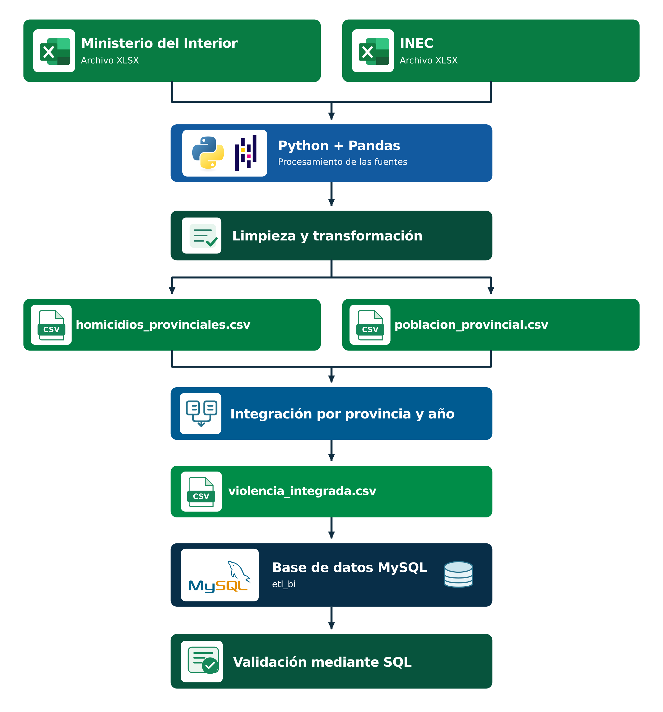
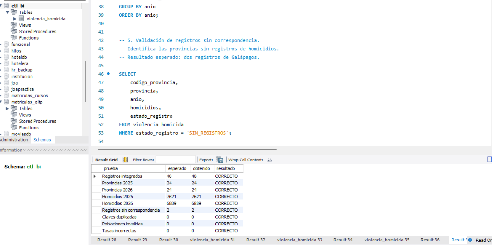
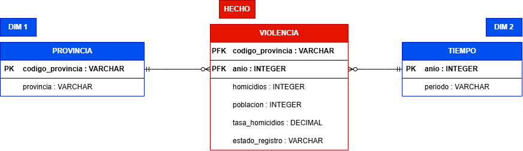

<h1 align="center">ETL_BI</h1>

<p align="center">
  <strong>Integración y preparación de datos abiertos sobre la violencia homicida en Ecuador</strong><br>
  Comparación provincial · Enero–octubre de 2025 y 2026
</p>

<p align="center">
  
  
  
  
  
</p>

---

 
**Asignatura:** Introducción a la Inteligencia de Negocios  
**Docente:** Ing. Ángel Eduardo Encalada Encalada

**Integrantes**

- Valeria Chuncho Granda
- Joel Domínguez Ochoa
- Jefferson Sánchez Torres

## Descripción del proyecto

Proyecto bimestral de la asignatura **Introducción a la Inteligencia de Negocios**. Se implementa un proceso ETL para integrar registros de homicidios intencionales del Ministerio del Interior con las proyecciones poblacionales del Instituto Nacional de Estadística y Censos (INEC).

El conjunto resultante permite comparar el número de homicidios y su tasa por cada 100.000 habitantes entre las provincias del Ecuador durante periodos equivalentes de 2025 y 2026.

**Pregunta de investigación:** ¿La reducción de homicidios intencionales en Ecuador durante 2026 se refleja en todas las provincias o se concentra en determinados territorios, respecto al mismo periodo de 2025?

## Fuentes de datos

| Institución | Conjunto de datos original | Fuente oficial |
|---|---|---|
| Ministerio del Interior | [Homicidios 2014–2025](datos_fuente/mdi_homicidiosintencionalse_pm_2014_2025.xlsx) | [Datos Abiertos Ecuador](https://www.datosabiertos.gob.ec/dataset/homicidios-intencionales) |
| Ministerio del Interior | [Homicidios enero–octubre 2026](datos_fuente/mdi_homicidiosintencionales_pm_2026_enero_octubre.xlsx) | [Datos Abiertos Ecuador](https://www.datosabiertos.gob.ec/dataset/homicidios-intencionales) |
| Ministerio del Interior | [Diccionario de datos](datos_fuente/mdi_homicidios_intencionales_dd_2025.xlsx) | [Datos Abiertos Ecuador](https://www.datosabiertos.gob.ec/dataset/homicidios-intencionales) |
| INEC | [Estimaciones y proyecciones poblacionales](datos_fuente/Tabulados_Estimacion_Proyeccion_v2.xlsx) | [Ecuador en Cifras](https://www.ecuadorencifras.gob.ec/proyecciones-poblacionales/) |

Los libros originales se conservan sin modificaciones en `datos_fuente/`. El diccionario sirve como referencia para interpretar los atributos; no constituye una tercera fuente temática.

[Ver evidencia de las fuentes oficiales](evidencias/fuentes_datos_oficiales.png)

## Arquitectura del proceso ETL

<p align="center">
  
</p>

El flujo utiliza Python y Pandas para preparar los datos y MySQL para almacenar y consultar el resultado integrado. Las claves de correspondencia son `codigo_provincia` y `anio`.

## Implementación

| Etapa | Script | Operaciones principales |
|---|---|---|
| Extracción | [`extraccion.py`](scripts_etl/extraccion.py) | Lectura de Excel, selección de hojas y atributos, exclusión de filas completamente vacías. |
| Transformación | [`transformacion.py`](scripts_etl/transformacion.py) | Conversión de fechas, filtrado temporal, normalización de códigos, agrupación y reorganización de la población. |
| Integración | [`integracion.py`](scripts_etl/integracion.py) | Unión por provincia y año, cálculo de tasas y exportación del CSV integrado. |
| Creación de la base de datos | [`crear_bd.sql`](scripts_etl/crear_bd.sql) | Creación de `etl_bi` y su tabla `violencia_homicida` con clave primaria compuesta. |
| Carga | [`carga.py`](scripts_etl/carga.py) | Conexión mediante variables de entorno, inserción de registros y comprobación de la carga. |
| Validación | [`validacion.sql`](scripts_etl/validacion.sql) | Verificación de calidad y consulta comparativa provincial de homicidios. |

### Decisiones de calidad e integración

- Los homicidios se filtran desde enero hasta octubre de ambos años para comparar periodos equivalentes.
- Los códigos provinciales se normalizan a dos caracteres, preservando los ceros iniciales.
- Se identifican 84 filas idénticas adicionales, que se conservan porque no existe un identificador único de víctima que permita comprobar que son duplicados reales.
- La integración utiliza una unión izquierda (`left join`) que conserva las 24 provincias en cada año.
- Los registros correspondientes a Galápagos se mantienen con estado `SIN_REGISTROS` y valores nulos en homicidios y tasa. La ausencia de correspondencia no se interpreta como cero homicidios.

### Integración por provincia y año

Fragmento de [`integracion.py`](scripts_etl/integracion.py):

```python
datos = poblacion.merge(
    homicidios,
    on=["codigo_provincia", "anio"],
    how="left",
    validate="one_to_one",
    indicator=True
)

datos["homicidios"] = datos["homicidios"].astype("Int64")
datos["tasa_homicidios_100mil"] = (
    datos["homicidios"] / datos["poblacion"] * 100000
).round(2)
```

### Indicador calculado

$$
\text{Tasa de homicidios} = \frac{\text{Homicidios registrados}}{\text{Población proyectada}} \times 100\,000
$$

La tasa corresponde a los primeros diez meses de cada año y utiliza la población proyectada anual como denominador; no representa una tasa anualizada.

## Estructura del repositorio

```text
ETL_BI/
├── datos_fuente/                  # Archivos originales XLSX
├── datos_resultantes/
│   ├── homicidios_provinciales.csv
│   ├── poblacion_provincial.csv
│   └── violencia_integrada.csv
├── scripts_etl/
│   ├── extraccion.py
│   ├── transformacion.py
│   ├── integracion.py
│   ├── crear_bd.sql
│   ├── carga.py
│   └── validacion.sql
├── evidencias/                    # Capturas, resultados y diagramas
├── .env.EXAMPLE                   # Plantilla de conexión
├── .gitignore
└── README.md
```

## Instalación y ejecución

### Requisitos

- Python 3, Git y MySQL Server.
- MySQL Workbench para ejecutar las consultas SQL.
- Bibliotecas Python: `pandas`, `openpyxl`, `mysql-connector-python` y `python-dotenv`.

### Clonar el repositorio

Desde PowerShell o la terminal de Visual Studio Code:

```powershell
git clone https://github.com/joeldo04/ETL_BI.git
cd ETL_BI
```

### Crear el entorno virtual e instalar las dependencias

```powershell
python -m venv .venv
.\.venv\Scripts\Activate.ps1
python -m pip install pandas openpyxl mysql-connector-python python-dotenv
```

### Configurar la conexión a MySQL

Crea el archivo local `.env` a partir de la [plantilla de configuración](.env.EXAMPLE):

```powershell
Copy-Item .env.EXAMPLE .env
```

Edita el archivo `.env` con las credenciales de tu instalación local de MySQL:

```dotenv
MYSQL_HOST=localhost
MYSQL_PORT=3306
MYSQL_USER=root
MYSQL_PASSWORD=
MYSQL_DATABASE=etl_bi
```

Completa la contraseña únicamente en tu archivo local. No publiques credenciales en GitHub.

### Crear la base de datos

Abre MySQL Workbench, conéctate a tu servidor y ejecuta el archivo [`crear_bd.sql`](scripts_etl/crear_bd.sql). Se crean la base de datos `etl_bi` y la tabla de destino `violencia_homicida`.

### Ejecutar el proceso ETL

Desde la raíz del proyecto y con el entorno virtual activo:

```powershell
python scripts_etl/extraccion.py
python scripts_etl/transformacion.py
python scripts_etl/integracion.py
python scripts_etl/carga.py
```

La extracción muestra los registros disponibles. La transformación genera los dos CSV intermedios; la integración genera `violencia_integrada.csv` y la carga almacena los 48 registros en MySQL.

> La carga está diseñada para una tabla de destino vacía. Si ya contiene el mismo conjunto, no vuelvas a ejecutar la inserción sin preparar previamente el destino, ya que existe una clave primaria compuesta.

### Validar los resultados

En MySQL Workbench selecciona la base de datos con:

```sql
USE etl_bi;
SELECT * FROM violencia_homicida;
```

A continuación, ejecuta el archivo [`validacion.sql`](scripts_etl/validacion.sql).

## Resultados

| Indicador | Resultado |
|---|---:|
| Registros históricos de homicidios extraídos | 39.822 |
| Registros de homicidios de 2026 extraídos | 6.889 |
| Registros poblacionales extraídos | 144 |
| Homicidios de enero–octubre de 2025 | 7.621 |
| Homicidios de enero–octubre de 2026 | 6.889 |
| Registros de homicidios agrupados | 46 |
| Registros poblacionales transformados | 48 |
| Registros integrados y almacenados | **48** |
| Provincias por año | 24 |
| Atributos del conjunto integrado | 7 |

Se registra una disminución de 732 homicidios (9,61 %) entre los periodos analizados. Sin embargo, la reducción no se refleja de manera uniforme: El Oro, por ejemplo, pasa de 625 a 974 homicidios, mientras Guayas pasa de 3.449 a 2.793. Galápagos no dispone de registros de homicidios que permitan realizar la comparación.

### Archivos resultantes

| Archivo | Contenido |
|---|---|
| [`homicidios_provinciales.csv`](datos_resultantes/homicidios_provinciales.csv) | Homicidios agrupados por provincia y año. |
| [`poblacion_provincial.csv`](datos_resultantes/poblacion_provincial.csv) | Población proyectada por provincia y año. |
| [`violencia_integrada.csv`](datos_resultantes/violencia_integrada.csv) | Conjunto final con población, homicidios, estado y tasa por 100.000 habitantes. |

### Validación mediante SQL

<p align="center">
  
</p>

Se comprueba la cobertura provincial, los totales de homicidios, la unicidad de las claves, la validez de las poblaciones y la coherencia de las tasas. También se verifica el tratamiento de los registros faltantes.

Por ejemplo, [`validacion.sql`](scripts_etl/validacion.sql) comprueba los totales almacenados para cada año:

```sql
SELECT anio, SUM(homicidios) AS total_homicidios
FROM violencia_homicida
GROUP BY anio
ORDER BY anio;
```

[Ver registros almacenados en MySQL](evidencias/registros_mysql.png) · [Ver comparación provincial](evidencias/comparacion_homicidios_provinciales.png)

## Propuesta de almacenamiento para BI

Se propone un **Data Mart de seguridad ciudadana** organizado mediante un esquema estrella. La tabla de hechos `VIOLENCIA` se relaciona con las dimensiones `PROVINCIA` y `TIEMPO`.

<p align="center">
  
</p>

- **Granularidad:** un registro por provincia y año, correspondiente al periodo enero–octubre.
- **Métricas:** cantidad de homicidios, población proyectada y tasa de homicidios por cada 100.000 habitantes.
- **Aplicación:** comparación temporal y geográfica, análisis de la evolución de la violencia y apoyo a futuras soluciones de Inteligencia de Negocios.

El esquema estrella constituye una propuesta conceptual; la implementación ETL de este proyecto utiliza una tabla integrada en MySQL. Las tasas no deben sumarse entre provincias: para calcular una tasa agregada se utiliza la suma de homicidios dividida entre la población correspondiente.

## Evidencias del proyecto

| Evidencia | Archivo |
|---|---|
| Fuentes oficiales | [Ver captura](evidencias/fuentes_datos_oficiales.png) |
| Configuración del entorno | [Ver captura](evidencias/configuracion_entorno.png) |
| Extracción | [Ver ejecución](evidencias/extraccion_ETL.png) |
| Transformación | [Ver ejecución](evidencias/transformacion_ETL.png) |
| Integración | [Ver ejecución](evidencias/integracionETL.png) |
| Carga en MySQL | [Ver ejecución](evidencias/carga_ETL.png) |
| Datos almacenados | [Ver registros](evidencias/registros_mysql.png) |
| Validación SQL | [Ver resultados](evidencias/validacion_sql.png) |
| Consulta comparativa | [Ver resultados](evidencias/comparacion_homicidios_provinciales.png) |
| Organización del proyecto | [Ver estructura](evidencias/estructura_proyecto.png) |
| Arquitectura ETL | [Ver diagrama](evidencias/arquitectura_proceso_etl.png) |
| Modelo multidimensional | [Ver diagrama](evidencias/modelo_estrella_multidimensional.png) |

---